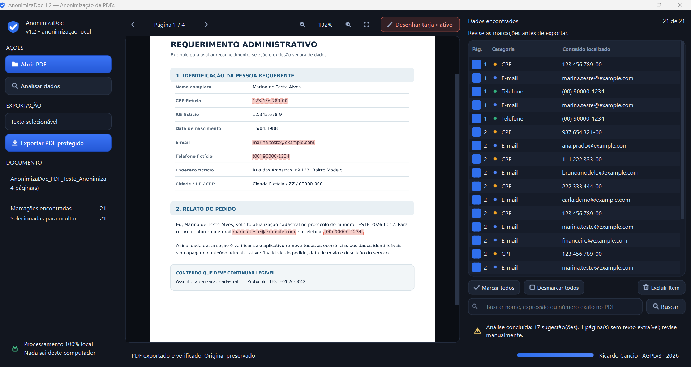

# AnonimizaDoc — Privacidade e Proteção Documental

O **AnonimizaDoc** é um aplicativo desktop de código aberto, desenvolvido em Python, para identificação, revisão e remoção de dados pessoais em documentos PDF.

O software permite aplicar tarjas de proteção, remover conteúdos selecionados e preservar as informações públicas dos documentos.

## Funcionalidades

- Detecção automática de CPF, RG, telefone e e-mail.
- Anonimização manual por seleção de áreas.
- Remoção efetiva dos dados selecionados.
- Aplicação de tarjas pretas.
- Preservação do texto pesquisável.
- Visualização de PDFs com zoom.
- Processamento local, sem envio dos documentos à internet.
- Exportação de PDFs tratados.

## Tecnologias

- Python
- PyMuPDF
- PySide6
- PyInstaller

## Interface do AnonimizaDoc

****

## Licença e autoria

**Desenvolvimento:** Ricardo Cancio  
**Versão:** 1.2  
**Licença:** GNU AGPLv3

© 2026 Ricardo Cancio.

O código Python próprio do AnonimizaDoc é disponibilizado sob a licença GNU AGPLv3.

As bibliotecas de terceiros permanecem sujeitas às suas respectivas licenças e direitos autorais.

**Aviso:** a anonimização exige revisão humana antes da divulgação de documentos.
